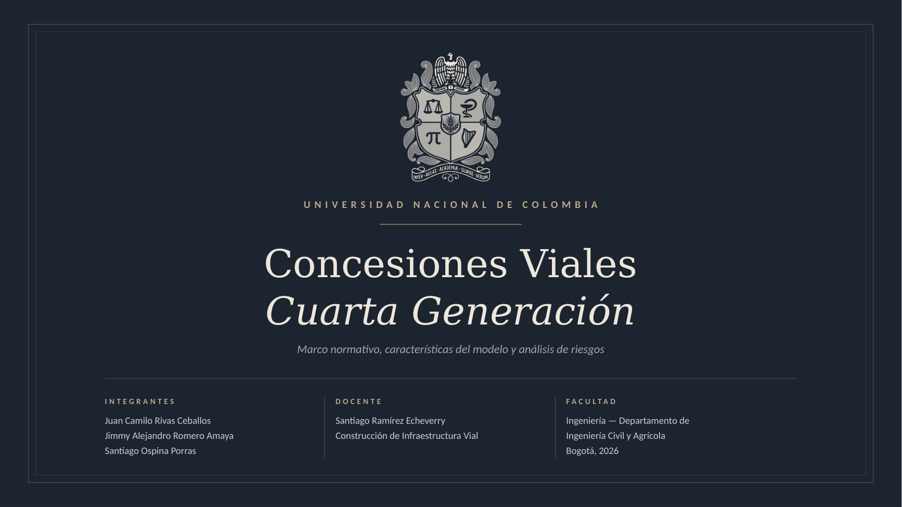
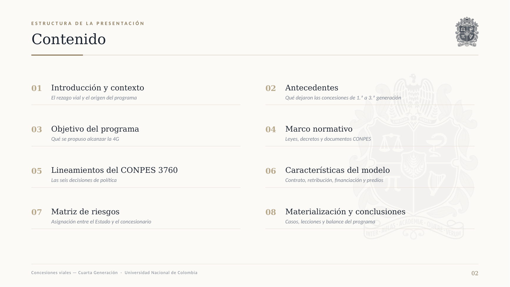
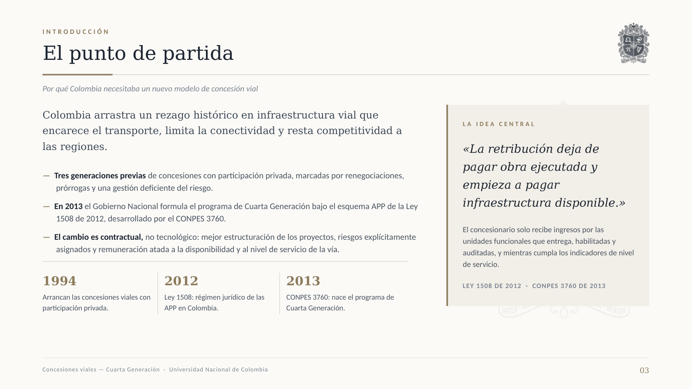
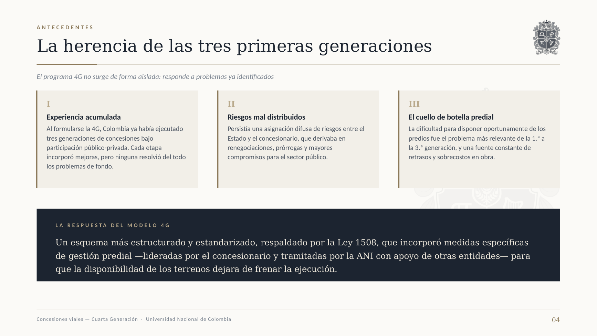
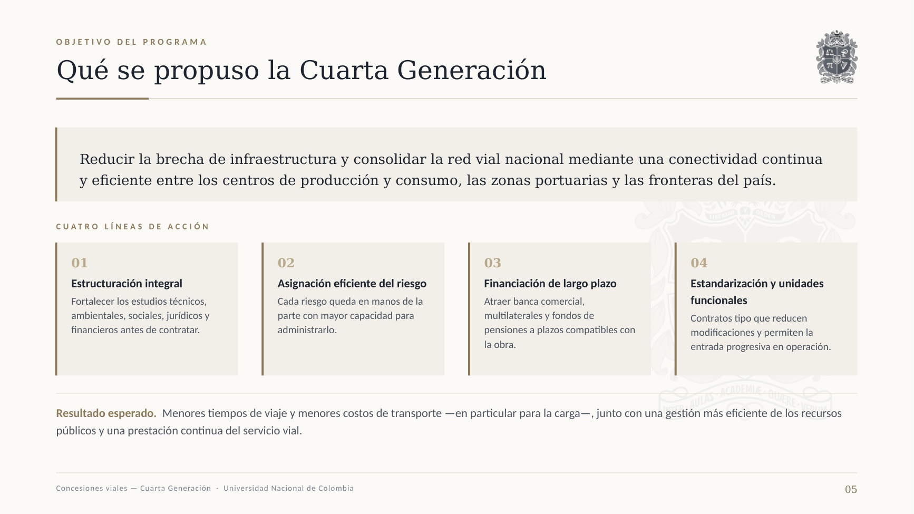
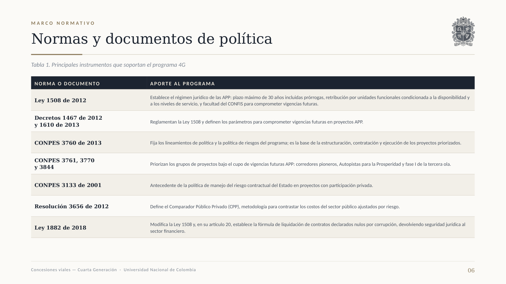
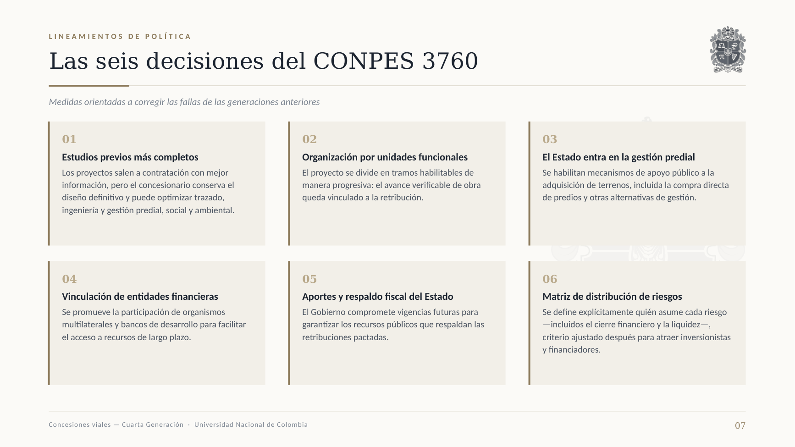
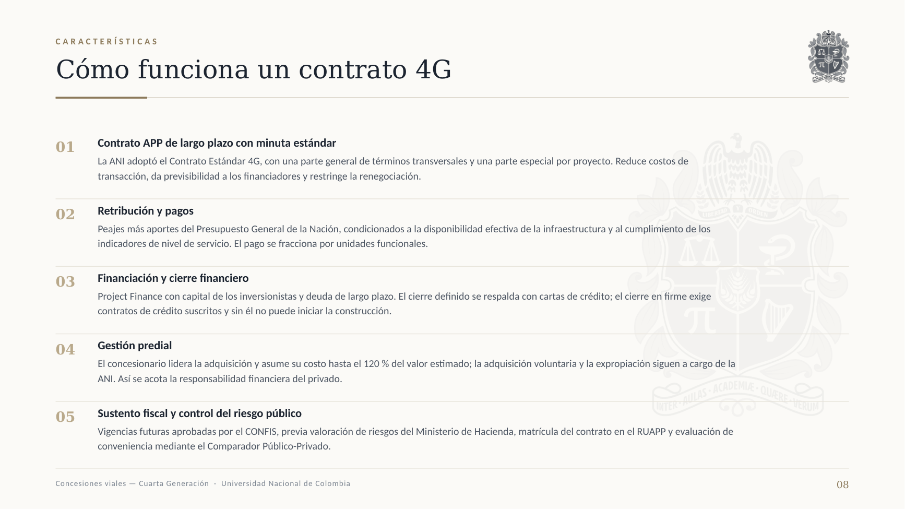
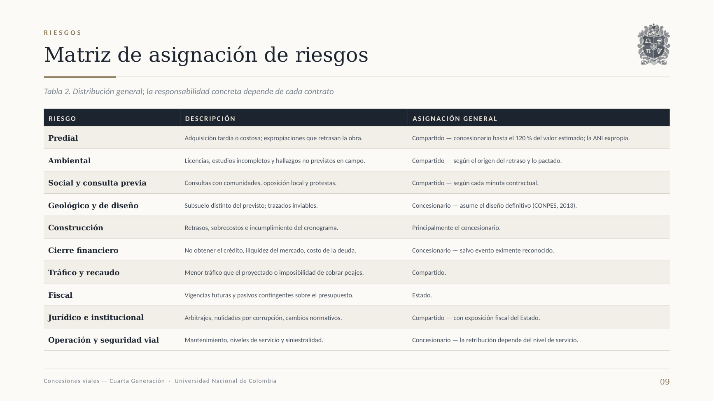
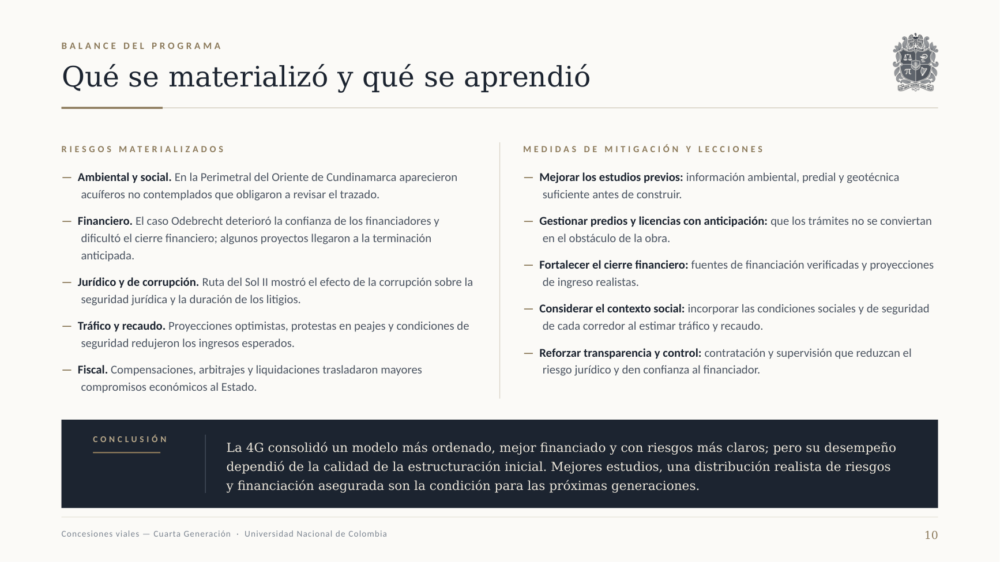

# Construcción de Infraestructura Vial

## Presentación — Concesiones Viales, Cuarta Generación (4G)

Universidad Nacional de Colombia · Facultad de Ingeniería · Departamento de Ingeniería Civil y Agrícola
Bogotá, 2026

**Integrantes:** Juan Camilo Rivas Ceballos · Jimmy Alejandro Romero Amaya · Santiago Ospina Porras
**Docente:** Santiago Ramírez Echeverry

### Archivos

| Archivo | Uso |
|---|---|
| [`Concesiones_Viales_4G_Presentacion.pptx`](Concesiones_Viales_4G_Presentacion.pptx) | Editable, 16:9 · 336 KB |
| [`Concesiones_Viales_4G_Presentacion.pdf`](Concesiones_Viales_4G_Presentacion.pdf) | Para exponer o imprimir · 685 KB |
| [`Presentacion_Concesiones_4G.zip`](Presentacion_Concesiones_4G.zip) | PPTX + PDF juntos · 928 KB |
| [`diapositivas/`](diapositivas) | Las 10 diapositivas en PNG |

---

### Las 10 diapositivas

Se pueden ver aquí mismo sin descargar nada. Para guardar una sola, clic derecho sobre la
imagen → *Guardar imagen como*.

**01 · Portada**

**02 · Contenido**

**03 · Introducción — el punto de partida**

**04 · Antecedentes — la herencia de las tres primeras generaciones**

**05 · Objetivo del programa**

**06 · Marco normativo (Tabla 1)**

**07 · Lineamientos del CONPES 3760**

**08 · Características del modelo 4G**

**09 · Matriz de riesgos (Tabla 2)**

**10 · Balance: riesgos materializados, lecciones y conclusión**

---

### Diseño

Paleta grafito `#1C2430`, marfil `#FBFAF7` y bronce apagado `#8C7A5B`. Títulos en Georgia y
texto en Calibri: ambas vienen de fábrica en Windows y macOS, así que la maquetación no se
descuadra al abrir el archivo en otro equipo.

El escudo de la Universidad Nacional está en versión monocromática tipo grabado: se convirtió a
luminancia y se reentintó en un solo color, conservando todo el detalle del original (el águila,
la balanza, el π, el arpa y la leyenda *Inter Aulas Academiæ Quære Verum*) sin los colores
institucionales rojo y verde.

Las tablas usan el estilo integrado «No Style, No Grid» y filetes horizontales definidos a mano,
para que PowerPoint no les aplique las bandas de color del tema.
